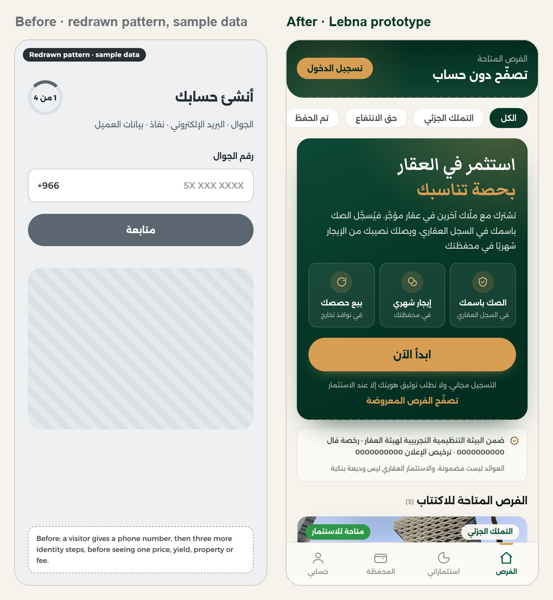
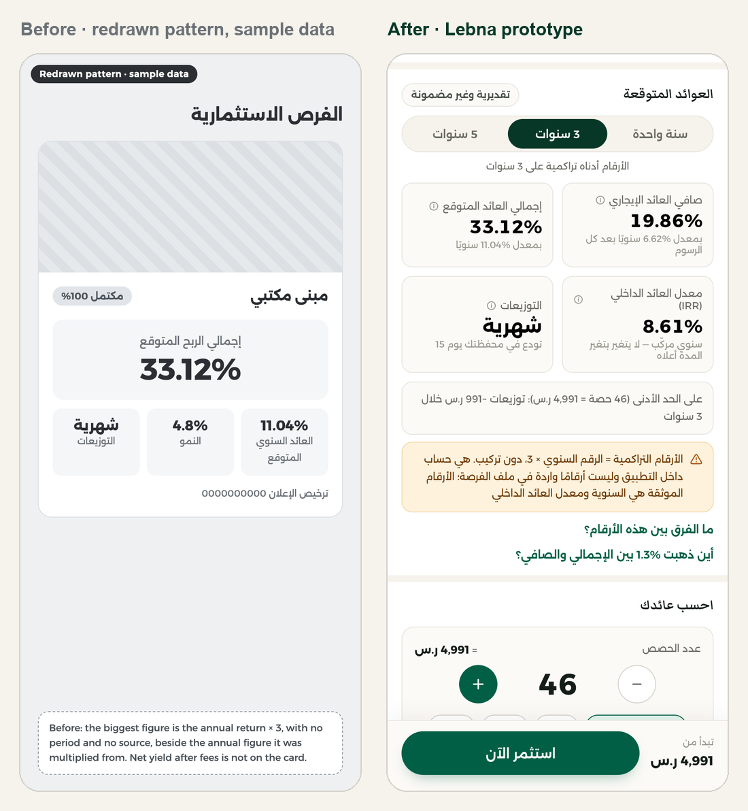
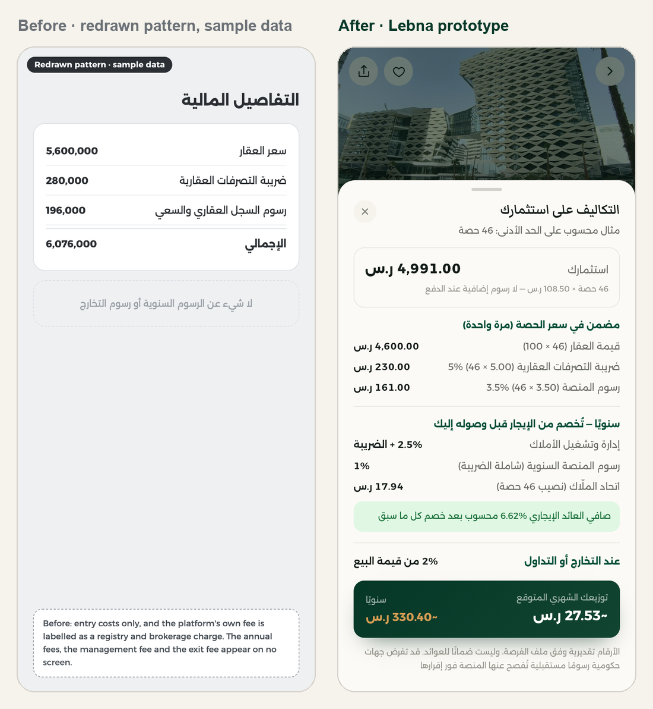
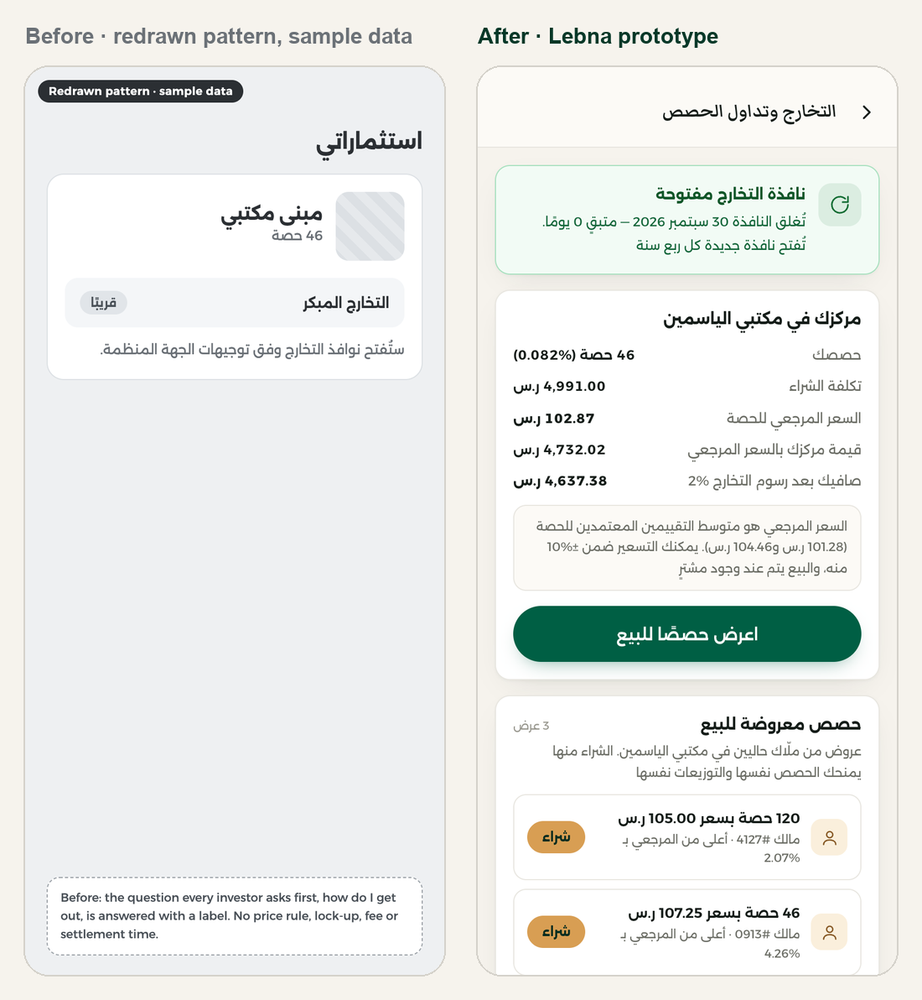
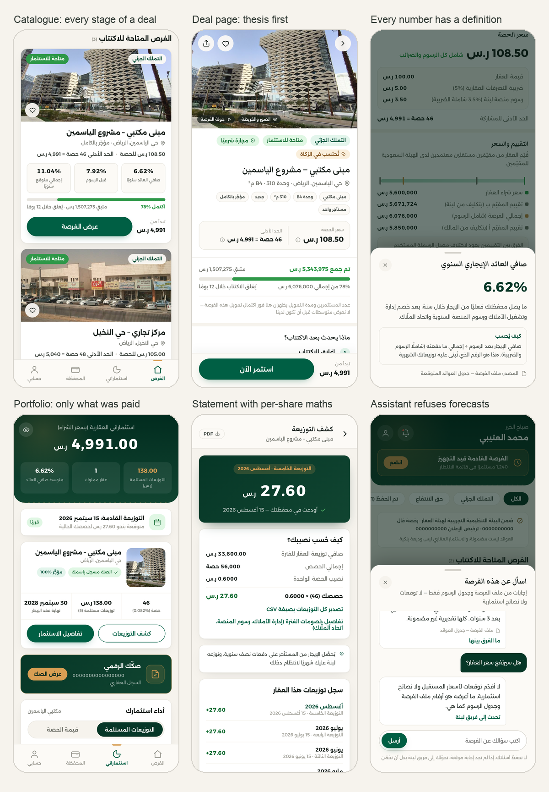
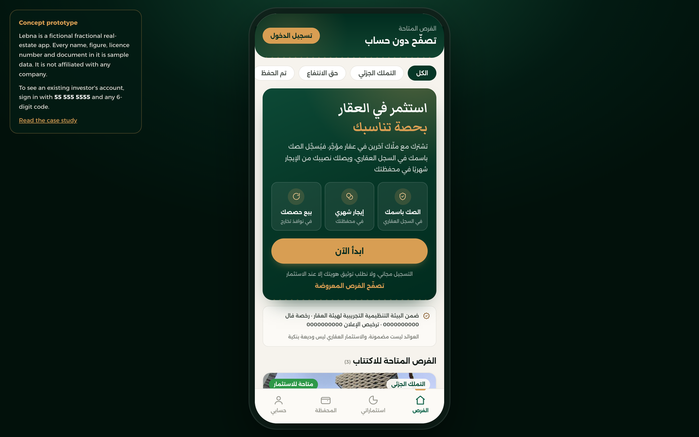

# Lebna: redesigning a Saudi fractional real-estate app

Lebna (لبنة, "a single brick") is a working prototype of a Saudi app that sells shares in rented buildings. I built it to answer an audit I ran on a live app in this market. I read 63 of its screens against its own documents, and 561 screens from five competing apps, all on a phone.

**[Watch the walkthrough](images/walkthrough.mp4)** (30 seconds, Arabic interface). The prototype code isn't published. This repo holds the case study and the research notes.

> Lebna is fictional. The app I audited isn't named here, and every name, figure, licence number and document in the prototype is sample data. It is not affiliated with any company.

## The short version

The app I audited was more honest than its competitors and harder to read than any of them. Of the six apps I compared, it was the only one that printed its yearly and exit fees or compared two independent valuations, and its payout statements were the only ones that showed the per-share arithmetic. None of that appeared on the screens where people decide. A visitor had to hand over a phone number before seeing a single price, and the biggest number on the deal card was a figure that none of the company's documents contained.

I rebuilt the journey as a working prototype: 42 screens, nine sample opportunities covering every stage of a deal's life, and an exit flow that runs all the way to settlement.

| | |
|---:|---|
| **63** | screens of the original app, captured on device and read against its four source documents (the opportunity file, two valuation reports and the subscription contract) |
| **561** | screens from five regional competitors, read on device |
| **42** | screens in the prototype, across guest, new-customer and investor states |
| **207** | automated acceptance checks passed by the last release |

## Four findings and what the prototype does about them

### 1. The app asked who you were before showing you anything

**Before.** A visitor saw four slides of promises and then a phone field, followed by three more identity steps: email, national ID through Nafath, and customer details. No price, yield, property or fee was visible until all of that was done.

**Why it matters.** Signicat puts abandonment of financial-services applications at 68%, and the two leading reasons ("it took too long" and "too much information was asked") are 21% each. Baymard finds that 18% of people who abandon a checkout leave because they were asked to create an account. One of the regional competitors already shows live deals, with the minimum ticket and yield, to visitors who have no account.

**After.** The app opens on the catalogue. A visitor can read every deal, fee, document and FAQ answer. The phone number is asked for only when they invest, deposit or set an alert, and the sign-in screen names what it unlocks ("sign in to complete your investment"). Nafath comes at the first investment, when motivation is highest.

### 2. The headline return was the annual figure multiplied by three

**Before.** The largest number on the deal card was the annual total return multiplied by the three-year term. It had no period on it and sat beside the annual figure it was calculated from. It appeared in none of the four source documents. The same screen carried the advertising licence number, which makes the card a licensed promotion. In Lebna's sample numbers, that's 33.12% printed where 11.04% a year belongs. The net yield after fees, the figure a buyer needs most, wasn't on the card at all.

**Why it matters.** A cumulative figure wearing an annual label is the cheapest thing in the app for a regulator, a journalist or a competitor to question, and the cheapest to fix. The UK's FCA had 19,766 financial promotions amended or withdrawn in 2024, almost double the year before. That isn't Saudi law, but it shows which way supervision of return claims is moving.

**After.** Three defined figures. Net rental yield after every fee (6.62%) sits with the gross yield (7.92%) beside it. The total expected annual return (11.04%) states its 4.8% growth assumption. The IRR (8.61%) includes the exit fee. A one, three and five-year selector shows cumulative figures on demand, each labelled تراكمي (cumulative), with a note that they are in-app arithmetic rather than document figures. Every number opens a sheet with its definition, how it is worked out and the document it comes from.

### 3. The app's strongest asset was hidden in the fee list

**Before.** The deal page listed entry costs only. The platform's own fee was labelled as a registry and brokerage charge, which contradicts the contract the investor signs. The yearly platform fee, the property-management fee, the owners' association charge and the exit fee appeared on no screen.

**Why it matters.** In TransUnion's 2025 investor study, 65% ranked trust and reputation among their top factors when choosing a provider, against 49% for fees and pricing, and 56% named fee transparency as the leading driver of trust. This app had the transparency and was showing it where nobody looked.

**After.** One cost sheet in three groups: paid once, paid yearly and paid on exit. It is worked out for the investor's own number of shares and adds up to the share price on screen. Each line uses the name the contract gives it.

### 4. The exit was a chip reading "coming soon"

**Before.** The question every investor asks before buying is how to get out. The app answered it with a chip reading قريبًا ("soon") and one line saying windows would open according to the regulator's guidance. There was no price rule, lock-up, fee or settlement time.

**After.** A full exit journey. There is a quarterly window with a countdown and a reference price equal to the mean of the two valuations per share. Offers must sit within ±10% of that price, after a six-month lock-up. The exit fee is shown against what the shares cost. Orders match in parts, the deed share transfers at the Real Estate Registry, and net proceeds reach the wallet within five working days. The prototype also covers the second route the contract allows, which is selling the whole property by owners' vote.

## What else is in the prototype

- **Catalogue.** Nine opportunities across both products (fractional ownership and usufruct) and seven stages, including one that failed to fund and refunded its investors. Adding a real deal is a data entry.
- **Between deals.** A waitlist that captures how much someone intends to invest, and alert rules on yield, minimum, city and product type.
- **Portfolio.** Two charts, both factual: one bar per payout actually paid, and the share's value as a range between the two valuations. No chart appears before the first payout.
- **Statements.** Each payout shows net rent ÷ total shares × your shares, with a CSV export that opens correctly in Excel, Arabic included.
- **Assistant and live chat.** They answer only from the opportunity's documents and print the source under every answer. They refuse forecasts and opinions before any keyword can match, and anything the documents don't cover becomes a support ticket.
- **Account and security.** A passcode and biometric lock, a fresh one-time code before a withdrawal or an IBAN change, a Hijri-year Zakat statement, corporate accounts, gifting wallet credit and a hide-balances switch.
- **Academy.** Five short lessons built from the deal's own figures. Each reading time is calculated from the lesson's word count, so no lesson can claim a length it doesn't have.

On a desktop browser the phone sits in a frame, with a note beside it explaining that the app and its data are fictional.

## What I would measure

I set no targets, because I didn't have the original app's baselines, and as far as I could tell it couldn't measure most of these yet. Instrumenting them would be the first job, before shipping anything.

| Stage | Metric | Why it matters |
|---|---|---|
| Top of funnel | Visitor → opportunity viewed | With guest browsing, this shows whether a listing is worth arriving for. |
| Intent | Opportunity viewed → sign-in started | If the deal page is doing its job, this rises even though identity is now asked later. |
| Conversion | Sign-in started → Nafath completed | Where regulated products lose people. Tracked separately from sign-in because the two fail for different reasons. |
| Between deals | Intent captured while nothing is open | Waitlist entries and alert rules per visit during an empty period. In the original app this was zero by construction. |
| Repeat | Second-subscription rate | Decides whether the business is a platform or a series of one-off raises. The monthly plan and reinvestment exist to move it. |
| Retention | Return rate on payout day | The one recurring moment the product owns. If people don't open the app when they're paid, nothing else in the loop holds. |

This is the order I would ship in:

1. **The gate and the return figures.** They are the funnel leak and the disclosure risk, and neither needs backend work.
2. **Trust.** The fee sheet, the valuation comparison, statements, and account security.
3. **The between-deals loop.** The notification feed, alert rules, the monthly plan, and a referral offer that states its condition.
4. **The exit journey,** once the regulator allows secondary trading. Nothing in the app promises a date before then.

## Questions only an operator can answer

Where the documents were silent, the prototype uses placeholder copy and doesn't invent an answer. These six need a decision from whoever runs the product:

- Support hours, and whether to publish them. The prototype uses Sunday to Thursday, 9:00 to 17:00, and never promises a response time.
- The step-by-step inheritance procedure. The deed already settles the principle.
- What an unverified visitor may lawfully see under the advertising licence.
- The documents and delegation rules for corporate accounts.
- Whether non-Saudis are eligible inside the regulatory sandbox.
- Whether a guardian may open an account for a minor.

## Competitor research

In September 2026 I read five regional apps on an iPhone. One was a mature UAE platform (359 screens). The other four were Saudi apps in the Real Estate General Authority's sandbox (83, 60, 51 and 8 screens). They are anonymised here as Peers A to E. The full notes are in [research/competitor-research.md](research/competitor-research.md), and the stage-by-stage audit of the original app is in [research/journey-audit.md](research/journey-audit.md).

| Capability | Who had it | Original app | Lebna |
|---|---|---|---|
| Browse without an account | Peer B | Phone number first | Guest-first; identity at the first investment |
| Defined return figures | Peers B and C | One undefined headline figure | Three defined figures, each with its source |
| Yearly and exit fees on screen | Nobody | Entry costs only, one misnamed | Once, yearly and on exit, adding up on screen |
| Two valuations compared | Nobody | PDFs only | Side by side, dated, per share |
| Waitlist and conditional alerts | Peer B | A notify button | Amount, yield, minimum, city and product |
| Grounded assistant | Peer C has one, ungrounded | Static FAQ | Documents only, source printed, forecasts refused |
| Live chat | Peer C | A list of channels | One persistent thread, published hours, tickets |
| Portfolio chart | All five, as projections | Empty placeholder | Payouts actually made, nothing before the first |
| Statement export | Peer A | None | CSV, downloaded or emailed |
| Exit and secondary sale | Peer A | "Coming soon" | Window, reference price, price band, settlement |
| Academy with runtimes | Peer A | None | Five lessons, reading time measured from the text |
| App lock and step-up | Peers D and E | Biometric prompt only | Passcode, biometrics, one-time code before money moves |
| English | All five | None | Still none, and the main gap left |

No app in the study was captured through payment, so checkout screens, consent wording and funded portfolios are unverified for all five.

## How I worked

This was a self-initiated project. I captured and read every screen on an iPhone, read the four source documents, wrote the findings and made the product decisions. Those decisions include no chart before the first payout, an assistant that only answers from documents and refuses forecasts, and no figure anywhere on the guest home page.

The prototype code and its acceptance tests were written by AI coding agents (Claude Code and OpenAI Codex) working from those decisions, over twelve releases. I reviewed the releases on a phone and against the test suite, which grew to 207 checks covering things like tag balance in every screen, Western digits everywhere, and no invented phone numbers, emails or response times.

The prototype shown here is an anonymised copy. I replaced the original brand, property, tenant, valuers, licence numbers, photos and figures with sample data. The figures were recalculated together so the arithmetic still adds up (46 shares × 108.50 = 4,991.00, for example). I then ran every screen for a guest, a new customer and an investor against the original build to confirm nothing broke. The research captures and source documents stay private because they contain personal and commercial data.

## Limits

- The interface is Arabic only. An English layer is the main gap.
- There is no backend. Accounts, payments, Nafath and one-time codes are simulated.
- Every figure is sample data. The deal photos are licensed photos of other buildings, and the licence numbers are zeros.
- The research never reached a checkout in any app, so payment flows were compared against nothing.

## Credits and sources

**Photos** (Wikimedia Commons, cropped): [KAFD 32](https://commons.wikimedia.org/wiki/File:KAFD_32.jpg) by Kolaiel, CC0 · [Al Khaleej, Riyadh (6)](https://commons.wikimedia.org/wiki/File:Al_Khaleej,_Riyadh_Saudi_Arabia_-_panoramio_(6).jpg) and [(5)](https://commons.wikimedia.org/wiki/File:Al_Khaleej,_Riyadh_Saudi_Arabia_-_panoramio_(5).jpg) by AAlsaiad, CC BY 3.0 · [Industrial Area No 1, Dammam](https://commons.wikimedia.org/wiki/File:Industrial_Area_No_1,_Dammam_32234,_Saudi_Arabia_-_panoramio_(7).jpg) by AAlsaiad, CC BY 3.0 · [2nd Industrial City, Dammam](https://commons.wikimedia.org/wiki/File:2nd_Industrial_City,_Dammam,_Saudi_Arabia_(9068880029).jpg) by Black Zero, CC BY 2.0 · [Downtown Khobar](https://commons.wikimedia.org/wiki/File:Downtown_Khobar.jpg) by King Eliot, CC BY-SA 4.0 · [Al-Shate'a, Jeddah](https://commons.wikimedia.org/wiki/File:Al-Shate%27a,_Jeddah_Saudi_Arabia_-_panoramio_(6).jpg) by kasman70, CC BY 3.0 · [Car world, Al Khobar](https://commons.wikimedia.org/wiki/File:Car_world,Ar_Rakah,_Al_khobar_-_panoramio.jpg) by Suresh Babunair, CC BY 3.0 · [Residential building on Olaya street](https://commons.wikimedia.org/wiki/File:Residential_building_on_Olaya_street_(12753702893).jpg) by Francisco Anzola, CC BY 2.0. The cropped versions keep their original licences.

**Maps** © OpenStreetMap contributors, ODbL. **Fonts:** Alexandria and Markazi Text, SIL Open Font License, via Google Fonts.

**Research cited:** Signicat, [The Battle to Onboard](https://www.signicat.com/the-battle-to-onboard-2022) · Baymard Institute, [cart abandonment research](https://baymard.com/lists/cart-abandonment-rate) · Nielsen Norman Group, [Login Walls Stop Users in Their Tracks](https://www.nngroup.com/articles/login-walls/) · TransUnion, [2025 wealth management study](https://newsroom.transunion.com/wealth-management-study) · Financial Conduct Authority, [financial promotions data 2024](https://www.fca.org.uk/data/financial-promotions-data-2024).

## Rights

Copyright (c) 2026 Moussa. All rights reserved. The text, images and research notes in this repo may be read and quoted with credit. They may not be copied, redistributed or reused as a product or template without written permission.
